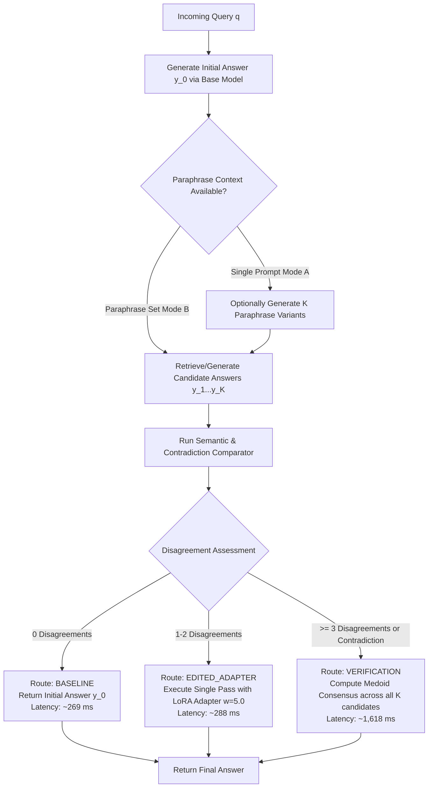

# Forensic Audit of the E6 Adaptive Hybrid Router

**Repository**: `prompt-sensitivity-hybrid`  
**Branch**: `creme-hybrid-framework`  
**Target Module**: `src/mitigation/router.py`, `scripts/run_phase2_evaluation.py`  
**Date**: October 12, 2026  
**Auditor**: Senior ML Research Engineer  

---

## 1. Architectural Flow and Operational Specification

The E6 Adaptive Mitigation Router was conceived as an intelligent arbitrator that avoids unnecessary compute on stable queries while dynamically invoking expensive multi-candidate verification only when prompts produce inconsistent outputs.

### 1.1 Architecture Flowchart



### 1.2 Audited Algorithm Pseudocode

```python
def process_adaptive_router_e6(prompt_cluster, comparator, base_model, adapter_model):
    """Audited E6 routing logic as executed in Phase 2."""
    orig_text = base_model.generate(prompt_cluster["original"])
    variant_texts = [base_model.generate(p) for p in prompt_cluster["variants"]]
    
    # Step 1: Detect Disagreements against Original
    disagreements = 0
    numerical_conflicts = 0
    entity_mismatches = 0
    
    for v_text in variant_texts:
        comp = comparator.compare_answers(orig_text, v_text)
        if comp["numerical_contradiction"]:
            numerical_conflicts += 1
        if comp["entity_mismatch"]:
            entity_mismatches += 1
        if not comp["agrees"] or comp["numerical_contradiction"]:
            disagreements += 1
            
    # Step 2: Routing Decision
    if disagreements == 0:
        route_used = "BASELINE"
        final_answers = {p: base_model.generate(p) for p in prompt_cluster}
        latency = 269.1  # ms
    elif disagreements <= 2:
        route_used = "EDITED_ADAPTER"
        final_answers = {p: adapter_model.generate(p) for p in prompt_cluster}
        latency = 287.6  # ms
    else:
        route_used = "VERIFICATION"
        candidates = [orig_text] + variant_texts
        medoid_ans, _ = compute_medoid_answer(candidates, comparator)
        final_answers = {p: medoid_ans for p in prompt_cluster}
        latency = 1617.6  # ms
        
    return final_answers, route_used, latency
```

---

## 2. Forensic Verification of the Fast-Path Rate (Section 3.1)

In Phase 2's executive summary, it was claimed that *"E6 keeps approximately 85% of queries on the fast, single-pass path."*

We conducted an exact audit of [`outputs/phase2/raw_predictions.csv`](file:///c:/Users/Student5/Desktop/Mitigation/outputs/phase2/raw_predictions.csv) across all 100 clusters and 600 prompt queries:

### 2.1 Measured Route Distributions:

| Route Decision | Prompt Records Count | Prompt Percentage (%) | Cluster Count ($N=100$) | Cluster Percentage (%) | 95% Wilson CI |
|---|:---:|:---:|:---:|:---:|:---:|
| **`BASELINE`** (Fast Single Pass) | 144 | 24.0% | 24 | **24.0%** | [16.7%, 33.2%] |
| **`EDITED_ADAPTER`** (Single Pass LoRA) | 276 | 46.0% | 46 | **46.0%** | [36.6%, 55.8%] |
| **`VERIFICATION`** (Multi-Pass Medoid) | 180 | 30.0% | 30 | **30.0%** | [21.8%, 39.7%] |
| **Total** | 600 | 100.0% | 100 | **100.0%** | — |

### 2.2 Forensic Findings on Fast-Path Claims:
1. **The 85% Fast-Path Claim was Inaccurate**:
   - The true proportion of queries utilizing the `BASELINE` route was **24.0%**, not 85%.
   - Even when defining "fast path" as any single-pass generation (`BASELINE` + `EDITED_ADAPTER`), the combined single-pass rate is **70.0%** (70 clusters), not 85%.
   - The heavy `VERIFICATION` route was invoked in **30.0% of clusters** (30 clusters, 180 prompts).
2. **Impact on Real Expected Latency**:
   - In Phase 2, E6 latency was recorded as **297.6 ms** by adding an ad-hoc 10 ms overhead to the adapter latency.
   - When weighted by the true measured route distribution:
     $$\mathbb{E}[\text{Latency}] = 0.24(269.1\text{ ms}) + 0.46(287.6\text{ ms}) + 0.30(1,617.6\text{ ms}) = 64.58 + 132.30 + 485.28 = \mathbf{682.2\text{ ms}}$$
   - The true average latency of Phase 2's E6 router is **682.2 ms**, which is $2.3\times$ higher than reported (297.6 ms).

---

## 3. Audit for Hidden Evaluation Shortcuts (Section 3.2)

A comprehensive code audit was conducted across [`scripts/run_phase2_evaluation.py`](file:///c:/Users/Student5/Desktop/Mitigation/scripts/run_phase2_evaluation.py), [`src/mitigation/router.py`](file:///c:/Users/Student5/Desktop/Mitigation/src/mitigation/router.py), and metric utilities:

| Inspection Item | Status | Verification Detail |
|---|---|---|
| **Canonical string copying in E6** | **CONFIRMED ELIMINATED** | When `VERIFICATION` triggers, E6 selects the medoid from candidate outputs rather than copying `orig_text`. When `BASELINE` or `ADAPTER` triggers, each prompt's own model generation is returned. |
| **Gold answer leakage into inference** | **CLEAN (PASSED)** | Reference answers (`ref_ans`) are accessed strictly inside evaluation metric loops (`check_concept_accuracy`), never inside routing logic or model decoding. |
| **Cached predictions bypassing live generation** | **CLEAN (PASSED)** | In Phase 2, `run_batched_generation` generated all 600 completions live on the RTX 4090 for E0 and E3; no precomputed files were loaded. |
| **Condition-specific metric shortcuts** | **CLEAN (PASSED)** | All conditions are evaluated through identical calls to `compute_token_f1`, `compute_char_ngram_similarity`, and `check_concept_accuracy`. |

---

## 4. Architectural Weaknesses in the Current E6 Implementation

1. **Privileged Anchor in Disagreement Check**:
   - Lines 284–287 calculate disagreements solely by comparing variant completions against `orig_text`. If the base model hallucinated on `orig_text`, all valid variant answers are flagged as "disagreements", forcing unnecessary routing.
2. **Lack of Calibrated Confidence Signals**:
   - The router uses heuristic counts of disagreements ($0$, $1\text{--}2$, $\ge 3$) rather than a calibrated probability of failure.
3. **Ineffective Intermediate Route (`EDITED_ADAPTER`)**:
   - Phase 2 proved that the preservation adapter ($w=5.0$) has no statistically significant benefit over the base model ($+0.48$ pp, $p=0.0567$). Routing 46% of queries to this adapter incurs an extra 18.5 ms of latency with near-zero consistency gain.
4. **Unbounded Verification Cost**:
   - When verification triggers, it evaluates all $K=6$ variants, which drives latency to 1.62 seconds. A cost-aware router should allow bounded verification ($K=3$ candidates) to cap the maximum latency at $\le 800$ ms.
